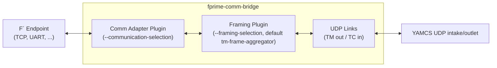
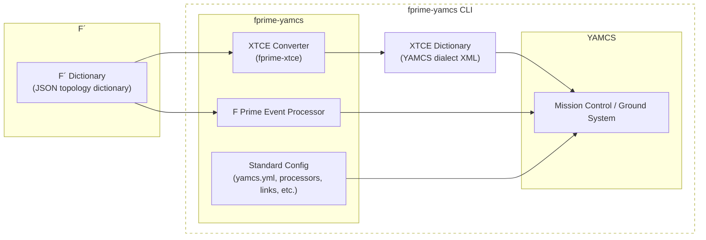

# fprime-yamcs: A YAMCS to F Prime Bridge Package

fprime-yamcs is designed to run YAMCS as the ground system when working with fprime. It operates similar to fprime-gds where it launches YAMCS in-lieu of the fprime-gds data pipelines.

## Requirements

`fprime-yamcs` is pip-only: `pip install fprime-yamcs` brings in everything needed to run,
including the YAMCS jars (`fprime-yamcs-bundle`, AGPL-3.0) and a trimmed Java runtime
([`fprime-jre`](https://github.com/fprime-community/fprime-jre), Eclipse Temurin 25, GPL-2.0
with Classpath Exception). Neither Maven nor a system JDK is required.

The launcher resolves Java in this order: `JAVA_HOME`, then `java` on the `PATH`, then the
pip-provided runtime — using the first candidate that is Java 17 or newer.

`fprime-jre` is published for Linux (x86_64, arm64), macOS (x86_64, arm64), and Windows
(x86_64), and installs automatically on those platforms via environment markers; it also puts
a `java` command on the `PATH` of the Python environment. On other platforms it is skipped:
`pip install fprime-yamcs` still succeeds, and a system Java 17+ must be provided (set
`JAVA_HOME` or add `java` to the `PATH`).

> [!NOTE]
> Developers working from a source checkout (rather than a released wheel) still need `mvn`
> and a JDK 17+ to build the jars: run `./scripts/build-jars.sh` once, or let the launcher
> fall back to `mvn yamcs:run`. The Maven fallback does not support `--yamcs-plugin-jars`
> and does not load entry-point discovered plugin jars.

## Usage

Install this package and run `fprime-yamcs` on a compatible F Prime deployment.

`fprime-yamcs` accepts the F Prime GDS communication adapter options (`--communication-selection` and the selected adapter's flags) and is a drop-in replacement for `fprime-gds` on the CCSDS TM/TC path. The default adapter is `tcp-fast-server` on port 50000, exactly as `fprime-gds` serves a `Drv.TcpClient` deployment: the launcher starts [`fprime-comm-bridge`](#communication-bridge-fprime-comm-bridge) automatically, which aggregates the TCP byte stream into complete TM transfer frames (`tm-frame-aggregator`, sized from the dictionary) and forwards them to the YAMCS UDP links. Any other adapter except `udp-fast` (which is the bridge's own YAMCS-side adapter) — `tcp-fast-client`, `ip`, `uart`, or an installed adapter plugin — is bridged the same way with its own flags forwarded. From the F Prime `Ref` deployment directory:

```
fprime-yamcs
```

Selecting `--communication-selection udp` expects the deployment to exchange UDP datagrams with the YAMCS links directly; no bridge is started.

> [!NOTE]
> TCP port 50000 (`--tcp-fast-port`) and the YAMCS UDP ports (`--udp-downlink-port` 50000, `--udp-uplink-port` 50001, `--udp-tm-inject-port` 50002 by default) do not conflict: TCP and UDP port numbers are independent. The legacy `ip` adapter binds both TCP and UDP on `--ip-port`, so it must differ from the YAMCS UDP ports (e.g. `--communication-selection ip --ip-port 50050`); the launcher refuses colliding ports. The deployment binary (`--app`) is launched with `-a`/`-p` matching the serving adapter (`--tcp-fast-address`/`--tcp-fast-port` or `--ip-address`/`--ip-port`).

> [!IMPORTANT]
> The bridge defaults require the `tcp-fast-server` and `tm-frame-aggregator` plugins of `fprime-gds` 4.4.0 or later. Framing plugins other than the CCSDS TM/TC path are not supported by the launcher.

## fprime-yamcs-events: Event Processor

`fprime-yamcs-events` runs the F Prime event processor standalone: it reads the F Prime JSON topology dictionary and publishes F Prime events into YAMCS. It is launched automatically by `fprime-yamcs`; run it directly when operating YAMCS without the full `fprime-yamcs` launcher.

### F´ Events Web Display

The YAMCS web interface gains an **F´ Events** page (sidebar item, served at `/ext/fprime-events`) providing the event display F Prime developers know from `fprime-gds`:

- Whole-row colors by F Prime severity (FATAL, WARNING_HI, WARNING_LO, ACTIVITY_HI, ACTIVITY_LO, COMMAND, DIAGNOSTIC), using a color-blind-safe palette derived from Okabe-Ito.
- Filtering by event ID (hex or decimal), event name, message text, severity (per-severity toggles), and time range.
- A virtualized table (only on-screen rows are rendered) with infinite scroll-back into the YAMCS event archive, plus a "Follow latest" toggle that keeps the view pinned to the newest event.

This works because the event processor publishes each event with structured `extra` fields (`fprime_severity`, `fprime_event_id`, `fprime_event_name`) preserving the full 7-level F Prime severity set, which YAMCS's native 5-level severity model cannot represent. The page is registered by the `FprimeEventsWebExtension` YAMCS plugin bundled with the YAMCS project that `fprime-yamcs` builds; no additional configuration is required. Events published by older versions of the event processor (without the `extra` fields) are shown with a best-effort severity derived from the YAMCS severity.

### Data-Flow Orb

Every YAMCS web page also gains the data-flow indicator F Prime developers know from the `fprime-gds` main screen: an orb in the top toolbar (left of STORAGE) that glows green while telemetry or events are flowing and turns into a red X once neither has been seen for 5 seconds (the same timeout `fprime-gds` uses). Hovering the orb shows a per-source breakdown (telemetry vs. events); the orb is grey while no YAMCS instance is selected.

Telemetry flow is detected from the selected processor's TM statistics stream (received-packet count deltas), and event flow from the instance's event stream, so the orb reflects live downlink activity regardless of which page is open.

## fprime-yamcs-tlmchan: Telemetry Channel Splitter

`Svc.TlmChan` packs multiple (id, time, value) telemetry channel records into a single downlinked packet, but the generated XTCE models one channel per packet keyed on the first channel id — so YAMCS alone only decodes the first record of each packet.

`fprime-yamcs-tlmchan` closes this gap: it reads the F Prime JSON topology dictionary, subscribes to the aggregate `FPrimeTelemetryChannel` container, walks every record in each packet, and re-injects each record beyond the first as a standalone single-record space packet on a dedicated UDP telemetry data link (`UDP_TM_SPLIT_IN`, default port 50002, configurable via `--udp-tm-inject-port` / `FPRIME_YAMCS_TM_INJECT_PORT`). YAMCS then decodes each injected packet through its normal XTCE path, publishing every channel as a parameter. It is launched automatically by `fprime-yamcs`; run it directly when operating YAMCS without the full `fprime-yamcs` launcher.

## Communication Bridge: fprime-comm-bridge

Non-`udp` communication adapters are bridged to the YAMCS UDP links by [`fprime-comm-bridge`](https://github.com/nasa/fprime-gds), which ships with `fprime-gds`. `fprime-yamcs` starts it automatically whenever a communication adapter other than `udp` is selected (`udp-fast` is the bridge's own YAMCS-side adapter and is rejected as a flight-side selection), forwarding the adapter options, the dictionary, and the configured YAMCS UDP ports and selecting `tm-frame-aggregator` framing; run it directly when operating YAMCS without the full launcher.

- The endpoint side is reached through an F Prime GDS **communication adapter plugin** (`--communication-selection`: `tcp-fast-server` by default on `--tcp-fast-port` 50000, or `tcp-fast-client`, `uart`, `ip`, or any installed adapter plugin).
- The YAMCS side is the `udp-fast` communication adapter: it pushes deframed packets as UDP datagrams to the telemetry intake (`--udp-fast-address`/`--udp-fast-send-port`, default `127.0.0.1:50000`) and receives command datagrams on a local UDP port (`--udp-fast-bind-address`/`--udp-fast-recv-port`, default `127.0.0.1:50001`). Command datagrams are only accepted from the peer address, loopback (`127.0.0.1`), and any hosts supplied via `--udp-fast-allowed-source`.
- One stage of framing/deframing sits in between, provided by an F Prime GDS **framing plugin** (`--framing-selection`). The default, `tm-frame-aggregator`, reassembles the endpoint byte stream into complete fixed-size CCSDS TM transfer frames (one per UDP datagram) and passes TC frames through unchanged, since YAMCS performs the CCSDS framing/deframing itself. It needs the frame size and spacecraft ID: pass `--dictionary <F Prime JSON dictionary>` or `--deployment <build output directory>` (reading `ComCfg.TmFrameFixedSize`/`ComCfg.SpacecraftId`; the launcher forwards its own dictionary) or `--frame-size`/`--scid` explicitly.

> [!NOTE]
> The UDP-transport requirement described under [Caveats](#caveats) applies to connecting F Prime directly to YAMCS; `fprime-comm-bridge` lifts it by bridging non-UDP endpoints (e.g. UART) to the YAMCS UDP links.

Example, serving a `Drv.TcpClient` deployment on TCP port 50000 with TM frames sized from the dictionary (all UDP flags shown use their default values):

```
fprime-comm-bridge --deployment build-artifacts/Linux/Ref \
    --udp-fast-address 127.0.0.1 --udp-fast-send-port 50000 --udp-fast-recv-port 50001
```



See the `fprime-gds` README for the full option set (other framings, `--udp-fast-allowed-source`, operational notes) and the bridge's tests.

## GDS Data Transport Plugin: `--data-transport-selection yamcs`

`fprime-yamcs` registers a `yamcs` **data transport plugin** (fprime-gds `data_transport` category, plugin class
`fprime_yamcs.gds.transport.YamcsClient`). Selecting it points the F Prime GDS pipeline (GDS GUI, `fprime-cli`, the
Integration Test API and `fprime_test_api_session` pytest fixture) at a running YAMCS server instead of the GDS comm
layer: commands are issued through the YAMCS processor and telemetry/events arrive from YAMCS parameter and event
subscriptions, so YAMCS becomes the ground system under test.

```bash
pytest test/int --dictionary <dict.json> --data-transport-selection yamcs --yamcs-url http://localhost:8090
```

| Argument | Default | Description |
| --- | --- | --- |
| `--yamcs-url` | `http://localhost:8090` | YAMCS server URL: `http://host[:port]`, `https://host[:port]`, or bare `host[:port]` (HTTP) |
|  |  | `user:password@` in the URL is handed to `yamcs-client` as login credentials and never logged; prefer this over an open server only on trusted hosts, since GDS command lines are visible to local users |
| `--yamcs-instance` | the single running instance | YAMCS instance to use; required when several instances run |
| `--yamcs-processor` | `realtime`, else the first processor of the instance | YAMCS processor to use (validated against the server) |

File uplink from the GDS (`fprime-cli`/test API `upload_file`) goes through the YAMCS file-transfer service
`FprimeFilePacketService` of the selected instance; the transport polls the transfer until it completes or fails.

> [!NOTE]
> Requires an `fprime-gds` with the `data_transport` plugin category ([nasa/fprime-gds#386](https://github.com/nasa/fprime-gds/pull/386)). Earlier `fprime-gds` releases (4.4.x) ship a
> built-in `fprime_gds.common.yamcs_transport` enabled by the pytest `--use-yamcs` / `--yamcs-url` options only
> (no `--yamcs-instance` / `--yamcs-processor`, `yamcs-client<2`); on an fprime-gds that has the `data-transport`
> category, the plugin from this package takes precedence over that built-in when both are installed; the GDS then logs `Ignoring data_transport plugin 'yamcs' from
> fprime_gds.common.yamcs_transport: already registered by fprime_yamcs.gds.transport` once per GDS process, which is
> expected until fprime-gds drops its built-in.

## Multiple spacecraft (secondary dictionaries)

One `fprime-yamcs` instance can receive several F Prime deployments at once, e.g. a flight unit and the
ground radio relaying it, as long as each has its own `ComCfg.SpacecraftId` and deployment name. Pass the
extra dictionaries with `--secondary-dictionary`:

```sh
fprime-yamcs -n --dictionary flight/dict/FlightTopologyDictionary.json \
    --communication-selection uart --uart-device /dev/ttyACM2 --uart-baud 115200 \
    --secondary-dictionary ground/dict/GroundRadioTopologyDictionary.json \
    --secondary-bridge-arguments "--communication-selection uart --uart-device /dev/ttyACM1 --uart-baud 115200"
```

Secondary N (1-based) gets, in the same YAMCS instance:

- its own XTCE space system (`/<DeploymentName>/...`), converted from its dictionary like the primary;
- a TM frame link, TC frame link and split-telemetry link copied from the primary's, carrying that dictionary's
  spacecraft id and frame size, on the primary UDP ports plus `10*N` (TM 50010, TC 50011, split 50012 for the
  first secondary with the default ports);
- TM/TC streams bound to its space system with `rootContainer` / `tcPatterns` (the primary streams are bound the
  same way), so each deployment's packets and commands only match its own XTCE;
- its own `fprime-yamcs-events` and `fprime-yamcs-tlmchan` processors (`--space-system <DeploymentName>`).

`--secondary-bridge-arguments` takes one quoted string of `fprime-comm-bridge` adapter arguments per secondary,
in order; the launcher starts a bridge per entry on that secondary's TM/TC ports, with the primary's framing
unless the string selects one (`--framing-selection`). Secondaries without an entry are not bridged: run your
own `fprime-comm-bridge --dictionary <secondary> --udp-fast-send-port <TM> --udp-fast-recv-port <TC> ...`.
SDLS and `--yamcs-realtime-only-channels` apply to the primary dictionary only. Parameters of the deployments
are distinct YAMCS parameters, so both can be plotted side by side.

## Configuration 

YAMCS is powerful and has many configuration properties. `fprime-yamcs` requires one instance of YAMCS defined in the configuration to have the following MDB:

```
mdb:
   - type: xtce
     args:
        file: .../fprime.xtce.xml
```

This is to allow for automatic dictionary generation. Users declining this service must specify: `--no-convert-dictionary`.

## SDLS Encryption (AES-256-GCM)

SDLS is off by default: frames are clear-text unless a key file is supplied. Deployments built on the
`Svc.ComCcsdsSdls` subtopology with `Svc.Ccsds.AesGcmEncryptor`/`AesGcmDecryptor` enable it with:

```sh
fprime-yamcs --yamcs-sdls-key-file path/to/sdls.key [--yamcs-sdls-spi 1]
```

The key file must hold exactly 32 bytes (AES-256) and be the same file read by the deployment's
`Svc.Ccsds.SdlsFileKeyManager`. When set, the generated YAMCS configuration decrypts TM and encrypts TC with
`org.yamcs.security.sdls.SecurityAssociationAes256Gcm128Factory` on the given SPI (default 1, matching the
F Prime `SdlsSaRouter` default map).

This flag configures YAMCS only. The deployment binary is launched exactly as `fprime-gds` launches it, so a
deployment that reads its key from `-k` must be given that argument through `--application-arguments`, which
replaces the default `-p`/`-a` arguments. The usual place is the project's `fprime-gds.yml`:

```yaml
command-line-options:
  communication-selection: udp
  yamcs-sdls-key-file: sdls.key
  application-arguments: ["-p", "50000", "-a", "0.0.0.0", "-k", "sdls.key"]
```

## Web Extensions

Projects may extend the YAMCS web interface with their own JavaScript:

```sh
fprime-yamcs --yamcs-web-extension-dirs path/to/extension-dir ...
```

Every top-level `.js` file in each directory is loaded as a module script by
the YAMCS web interface, and the directory's files are served alongside the
webapp's static files. Paths must not contain commas or whitespace.

Extensions may also be shipped as pip packages: include the extension directory as package
data and advertise it through a `fprime_yamcs.web_extensions` entry point resolving to the
directory path (a `str`/`Path`, an iterable of them, or a zero-argument callable returning
either). Installed extensions are discovered automatically — no flags required:

```toml
[project.entry-points."fprime_yamcs.web_extensions"]
my_extension = "my_package:WEB_EXTENSION_DIR"
```

## YAMCS Plugins

Projects with their own Java YAMCS plugins can add jars to the YAMCS classpath:

```sh
fprime-yamcs --yamcs-plugin-jars path/to/plugin.jar path/to/jar-dir ...
```

Plugin jars may also be shipped as pip packages: build the jar in CI (the reusable
[`build-yamcs-plugin.yml`](.github/workflows/build-yamcs-plugin.yml) workflow does this),
include it as package data, and advertise it through a `fprime_yamcs.plugin_jars` entry point
resolving to the jar (or a directory of jars). Installed plugin jars are discovered
automatically. On the classpath, the YAMCS jars come first, then the fprime-yamcs plugin
jar, then entry-point discovered jars, then `--yamcs-plugin-jars` values:

```toml
[project.entry-points."fprime_yamcs.plugin_jars"]
my_plugin = "my_package:PLUGIN_JAR"
```

## Packages and Licensing

| Package | Contents | License |
| --- | --- | --- |
| `fprime-yamcs` | Python code + the fprime-yamcs YAMCS plugin jar | Apache-2.0 |
| `fprime-yamcs-bundle` | YAMCS and its dependency jars | AGPL-3.0 |
| [`fprime-jre`](https://github.com/fprime-community/fprime-jre) | jlink-trimmed Eclipse Temurin Java runtime | GPL-2.0 with Classpath Exception |

## Caveats

Currently, the default configuration of YAMCS requires F Prime to connect a CCSDS TC/TM framer/deframer to the Drv.Udp component ensuring that UDP is the transport mechanism, unless a non-`udp` communication adapter is selected (the default `tcp-fast-server`, `uart`, ...) so that `fprime-comm-bridge` bridges the endpoint to the YAMCS UDP links.


